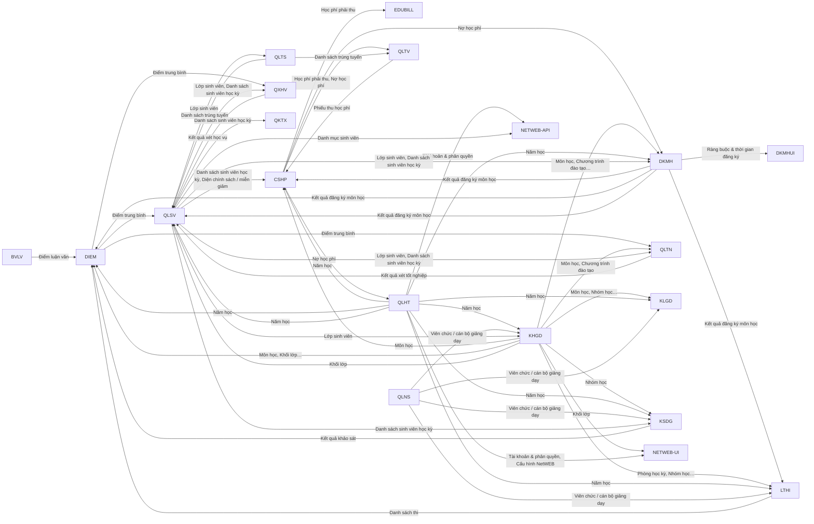

# Bản đồ phân hệ – dữ liệu chảy giữa các phân hệ

Đọc theo chiều mũi tên: phân hệ bên trái **tạo** dữ liệu, phân hệ bên phải **dùng**. Sửa một phân hệ → kiểm lại các phân hệ ở phía sau nó;
lỗi ở một phân hệ → kiểm dữ liệu đầu vào từ các phân hệ phía trước. Chi tiết từng dữ liệu ở thư mục `Du-lieu/`.

## Chuỗi chính (lưu đồ LuuDo_NEW)

- [[QLTS]] xét tuyển → **DS trúng tuyển** → [[QLSV]] (QĐ vào mới → DS SV học kỳ) và [[QLTV]] (học phí nhập học).
- [[KHGD]] CTĐT → nhóm học → thời khóa biểu; cùng **DS SV học kỳ** ([[QLSV]]) → [[DKMH]] → **KQ ĐKMH**.
- KQ ĐKMH → [[CSHP]] tính học phí → nợ học phí → [[QLTV]] thu (web: [[EDUBILL]]).
- KQ ĐKMH → [[LTHI]] danh sách thi → lịch thi.
- KQ ĐKMH → [[DIEM]] nhập điểm → **điểm TB** → [[QXHV]] học vụ, [[QLTN]] tốt nghiệp (→ [[QLSV]] QĐ tốt nghiệp), [[QLSV]] học bổng.
- [[BVLV]] điểm luận văn → [[DIEM]]; [[KSDG]] khảo sát theo nhóm học / GV; [[KLGD]] khối lượng từ nhóm học + TKB + viên chức.
- Nợ học phí ([[CSHP]]) quay lại chặn [[DKMH]] và chặn xem web ([[QLHT]] cấu hình NetWEB).
- Web: [[NETWEB-UI]], [[NETWEB-API]], [[DKMHUI]] hiển thị / ghi dữ liệu của các phân hệ trên; năm học – học kỳ và phân quyền ở [[QLHT]] dùng cho tất cả.

## Sơ đồ (Obsidian vẽ tự động)

## Dữ liệu dùng chung
- [[Hoc ky|Năm học – học kỳ]] – tạo ở [[QLHT]], dùng ở [[CSHP]], [[DIEM]], [[DKMH]], [[KHGD]], [[KLGD]], [[KSDG]], [[LTHI]], [[QLSV]]
- [[Tai khoan va phan quyen|Tài khoản & phân quyền]] – tạo ở [[QLHT]], dùng ở [[NETWEB-API]], [[NETWEB-UI]]
- [[Cau hinh NetWEB|Cấu hình NetWEB]] – tạo ở [[QLHT]], dùng ở [[NETWEB-UI]]
- [[Mon hoc|Môn học]] – tạo ở [[KHGD]], dùng ở [[CSHP]], [[DIEM]], [[DKMH]], [[KLGD]], [[QLTN]]
- [[Khoi lop|Khối lớp (khóa đào tạo của 1 ngành)]] – tạo ở [[KHGD]], dùng ở [[DIEM]], [[NETWEB-UI]], [[QLSV]]
- [[Lop sinh vien|Lớp sinh viên]] – tạo ở [[QLSV]], dùng ở [[DKMH]], [[KHGD]], [[QLTN]], [[QLTS]], [[QXHV]]
- [[CTDT|Chương trình đào tạo (chuẩn → kế hoạch → thực hiện)]] – tạo ở [[KHGD]], dùng ở [[DKMH]], [[QLTN]]
- [[DS trung tuyen|Danh sách trúng tuyển]] – tạo ở [[QLTS]], dùng ở [[QLSV]], [[QLTV]]
- [[Danh muc sinh vien|Danh mục sinh viên (mọi SV của trường)]] – tạo ở [[QLSV]], dùng ở [[NETWEB-API]]
- [[DS SV hoc ky|Danh sách sinh viên học kỳ]] – tạo ở [[QLSV]], dùng ở [[CSHP]], [[DKMH]], [[KSDG]], [[QKTX]], [[QLTN]], [[QXHV]]
- [[Dien chinh sach|Diện chính sách / miễn giảm]] – tạo ở [[QLSV]], dùng ở [[CSHP]]
- [[Vien chuc|Viên chức / cán bộ giảng dạy]] – tạo ở [[QLNS]], dùng ở [[KHGD]], [[KLGD]], [[KSDG]], [[LTHI]]
- [[Phong hoc|Phòng học kỳ]] – tạo ở [[KHGD]], dùng ở [[LTHI]]
- [[Nhom hoc|Nhóm học (nhóm tổ)]] – tạo ở [[KHGD]], dùng ở [[DIEM]], [[DKMH]], [[KLGD]], [[KSDG]], [[LTHI]]
- [[Thoi khoa bieu|Thời khóa biểu]] – tạo ở [[KHGD]], dùng ở [[DKMH]], [[KLGD]], [[LTHI]]
- [[Rang buoc DKMH|Ràng buộc & thời gian đăng ký]] – tạo ở [[DKMH]], dùng ở [[DKMHUI]]
- [[KQ DKMH|Kết quả đăng ký môn học]] – tạo ở [[DKMH]], dùng ở [[CSHP]], [[DIEM]], [[LTHI]], [[QLSV]]
- [[Hoc phi|Học phí phải thu (đã tính)]] – tạo ở [[CSHP]], dùng ở [[EDUBILL]], [[QLTV]]
- [[No hoc phi|Nợ học phí]] – tạo ở [[CSHP]], dùng ở [[DKMH]], [[QLHT]], [[QLTV]]
- [[Phieu thu|Phiếu thu học phí]] – tạo ở [[QLTV]], dùng ở [[CSHP]]
- [[Danh sach thi|Danh sách thi – lịch thi]] – tạo ở [[LTHI]], dùng ở [[DIEM]]
- [[Diem luan van|Điểm luận văn]] – tạo ở [[BVLV]], dùng ở [[DIEM]]
- [[Diem trung binh|Điểm trung bình – tích lũy]] – tạo ở [[DIEM]], dùng ở [[QLSV]], [[QLTN]], [[QXHV]]
- [[Ket qua hoc vu|Kết quả xét học vụ]] – tạo ở [[QXHV]], dùng ở [[QLSV]]
- [[Ket qua tot nghiep|Kết quả xét tốt nghiệp]] – tạo ở [[QLTN]], dùng ở [[QLSV]]
- [[Ket qua khao sat|Kết quả khảo sát]] – tạo ở [[KSDG]], dùng ở [[DIEM]]

Xem dạng mạng: mở **Graph view** (biểu tượng ở thanh trái) – mỗi chấm là một ghi chú, đường nối là liên kết.
