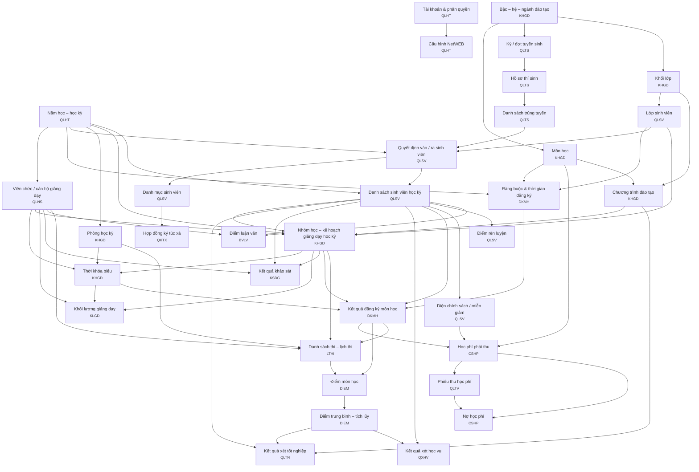

# Logic nghiệp vụ – muốn có X thì phải có Y

Mọi dữ liệu trong Edusoft / Netweb nằm trên một **chuỗi điều kiện**: phải khai báo dữ liệu tầng dưới thì mới tạo được dữ liệu tầng trên.
Ví dụ: muốn có **sinh viên** thì phải **tuyển sinh** (hồ sơ → trúng tuyển → quyết định vào mới); có **sinh viên + giảng viên + CTĐT**
thì mới có **kế hoạch giảng dạy** (nhóm học) → **thời khóa biểu** → SV **đăng ký môn học** → **học phí, lịch thi, điểm** → **học vụ, tốt nghiệp**.

Tầng = số bước dữ liệu phải đi qua trước (tầng 0 khai báo đầu tiên). Dùng khi đọc case ACS:
1. Case nói tới menu / dữ liệu nào → tìm ghi chú dữ liệu đó (tầng mấy, phân hệ nào).
2. **Chuẩn bị dữ liệu test** = các dữ liệu tầng dưới nó (mục "Chuẩn bị dữ liệu test" trong ghi chú) – phải có sẵn trên môi trường test.
3. **Kiểm tra không ảnh hưởng** = dữ liệu tầng trên sinh ra từ nó + các phân hệ dùng nó.
4. Hai case cùng chạm một dữ liệu (hoặc dữ liệu cha – con) là **case liên quan** – test cùng nhau, dùng chung dữ liệu chuẩn bị.

## Khẳng định theo tầng

### Tầng 0 – nền, khai báo đầu tiên
- Muốn có **[[Danh muc dao tao|Bậc – hệ – ngành đào tạo]]** ([[KHGD]]) – không cần gì trước (dữ liệu nền).
- Muốn có **[[Hoc ky|Năm học – học kỳ]]** ([[QLHT]]) – không cần gì trước (dữ liệu nền).
- Muốn có **[[Tai khoan va phan quyen|Tài khoản & phân quyền]]** ([[QLHT]]) – không cần gì trước (dữ liệu nền).

### Tầng 1
- Muốn có **[[Cau hinh NetWEB|Cấu hình NetWEB]]** ([[QLHT]]) thì phải có: [[Tai khoan va phan quyen|Tài khoản & phân quyền]] (người dùng quản trị NetWEB)
- Muốn có **[[Khoi lop|Khối lớp (khóa đào tạo của 1 ngành)]]** ([[KHGD]]) thì phải có: [[Danh muc dao tao|Bậc – hệ – ngành đào tạo]] (khối lớp = khóa của một ngành / bậc hệ)
- Muốn có **[[Ky tuyen sinh|Kỳ / đợt tuyển sinh (ngành, khối, phương thức)]]** ([[QLTS]]) thì phải có: [[Danh muc dao tao|Bậc – hệ – ngành đào tạo]] (ngành tuyển sinh lấy từ ngành đào tạo)
- Muốn có **[[Mon hoc|Môn học]]** ([[KHGD]]) thì phải có: [[Danh muc dao tao|Bậc – hệ – ngành đào tạo]] (môn học thuộc khoa / ngành quản lý)
- Muốn có **[[Phong hoc|Phòng học kỳ]]** ([[KHGD]]) thì phải có: [[Hoc ky|Năm học – học kỳ]] (danh sách phòng học kỳ)
- Muốn có **[[Vien chuc|Viên chức / cán bộ giảng dạy]]** ([[QLNS]]) thì phải có: [[Hoc ky|Năm học – học kỳ]] (danh sách viên chức học kỳ)

### Tầng 2
- Muốn có **[[CTDT|Chương trình đào tạo (chuẩn → kế hoạch → thực hiện)]]** ([[KHGD]]) thì phải có: [[Mon hoc|Môn học]] (chương trình gồm các môn học); [[Khoi lop|Khối lớp]] (CTĐT kế hoạch / thực hiện theo khối lớp)
- Muốn có **[[Ho so thi sinh|Hồ sơ thí sinh]]** ([[QLTS]]) thì phải có: [[Ky tuyen sinh|Kỳ / đợt tuyển sinh]] (hồ sơ nhập theo kỳ / đợt, ngành, phương thức)
- Muốn có **[[Lop sinh vien|Lớp sinh viên]]** ([[QLSV]]) thì phải có: [[Khoi lop|Khối lớp]] (lớp thuộc một khối lớp)

### Tầng 3
- Muốn có **[[DS trung tuyen|Danh sách trúng tuyển]]** ([[QLTS]]) thì phải có: [[Ho so thi sinh|Hồ sơ thí sinh]] (xét tuyển trên hồ sơ + điểm chuẩn)
- Muốn có **[[Rang buoc DKMH|Ràng buộc & thời gian đăng ký]]** ([[DKMH]]) thì phải có: [[Mon hoc|Môn học]] (môn tiên quyết / học trước / song hành); [[Lop sinh vien|Lớp sinh viên]] (thời gian đăng ký theo lớp); [[Hoc ky|Năm học – học kỳ]] (đợt đăng ký của học kỳ)

### Tầng 4
- Muốn có **[[Quyet dinh sinh vien|Quyết định vào / ra sinh viên]]** ([[QLSV]]) thì phải có: [[DS trung tuyen|Danh sách trúng tuyển]] (QĐ vào mới cho thí sinh trúng tuyển); [[Lop sinh vien|Lớp sinh viên]] (SV được xếp vào lớp); [[Hoc ky|Năm học – học kỳ]] (quyết định có hiệu lực từ học kỳ)

### Tầng 5
- Muốn có **[[DS SV hoc ky|Danh sách sinh viên học kỳ]]** ([[QLSV]]) thì phải có: [[Quyet dinh sinh vien|Quyết định vào / ra sinh viên]] (tổng hợp tự động từ quyết định vào / ra); [[Hoc ky|Năm học – học kỳ]] (danh sách theo từng học kỳ)
- Muốn có **[[Danh muc sinh vien|Danh mục sinh viên (mọi SV của trường)]]** ([[QLSV]]) thì phải có: [[Quyet dinh sinh vien|Quyết định vào / ra sinh viên]] (QĐ vào mới tạo hồ sơ sinh viên)

### Tầng 6
- Muốn có **[[Diem luan van|Điểm luận văn]]** ([[BVLV]]) thì phải có: [[DS SV hoc ky|Danh sách sinh viên học kỳ]] (SV bảo vệ luận văn); [[Vien chuc|Viên chức / cán bộ giảng dạy]] (hội đồng, giảng viên hướng dẫn)
- Muốn có **[[Diem ren luyen|Điểm rèn luyện]]** ([[QLSV]]) thì phải có: [[DS SV hoc ky|Danh sách sinh viên học kỳ]] (đánh giá rèn luyện SV trong học kỳ)
- Muốn có **[[Dien chinh sach|Diện chính sách / miễn giảm]]** ([[QLSV]]) thì phải có: [[DS SV hoc ky|Danh sách sinh viên học kỳ]] (diện chính sách gán cho SV trong học kỳ)
- Muốn có **[[Hop dong KTX|Hợp đồng ký túc xá]]** ([[QKTX]]) thì phải có: [[Danh muc sinh vien|Danh mục sinh viên]] (hợp đồng lập cho sinh viên)
- Muốn có **[[Nhom hoc|Nhóm học – kế hoạch giảng dạy học kỳ (nhóm tổ)]]** ([[KHGD]]) thì phải có: [[CTDT|Chương trình đào tạo]] (biểu đồ kế hoạch học tập của lớp → môn mở trong học kỳ); [[Lop sinh vien|Lớp sinh viên]] (lớp học kỳ cần học môn); [[DS SV hoc ky|Danh sách sinh viên học kỳ]] (sĩ số lớp → số nhóm); [[Vien chuc|Viên chức / cán bộ giảng dạy]] (phân công giảng viên cho nhóm); [[Hoc ky|Năm học – học kỳ]] (nhóm học thuộc học kỳ)

### Tầng 7
- Muốn có **[[Ket qua khao sat|Kết quả khảo sát]]** ([[KSDG]]) thì phải có: [[Nhom hoc|Nhóm học – kế hoạch giảng dạy học kỳ]] (đánh giá theo nhóm học / giảng viên); [[Vien chuc|Viên chức / cán bộ giảng dạy]] (giảng viên được đánh giá); [[DS SV hoc ky|Danh sách sinh viên học kỳ]] (đáp viên)
- Muốn có **[[Thoi khoa bieu|Thời khóa biểu]]** ([[KHGD]]) thì phải có: [[Nhom hoc|Nhóm học – kế hoạch giảng dạy học kỳ]] (xếp lịch cho từng nhóm học); [[Phong hoc|Phòng học kỳ]] (tìm phòng trống); [[Vien chuc|Viên chức / cán bộ giảng dạy]] (không trùng lịch giảng viên)

### Tầng 8
- Muốn có **[[KQ DKMH|Kết quả đăng ký môn học]]** ([[DKMH]]) thì phải có: [[DS SV hoc ky|Danh sách sinh viên học kỳ]] (chỉ SV có trong DS SV học kỳ mới đăng ký được); [[Nhom hoc|Nhóm học – kế hoạch giảng dạy học kỳ]] (chọn nhóm học còn chỗ); [[Thoi khoa bieu|Thời khóa biểu]] (nhóm có lịch, không trùng TKB); [[Rang buoc DKMH|Ràng buộc & thời gian đăng ký]] (được phép đăng ký (thời gian, tiên quyết, tín chỉ, nợ học phí))
- Muốn có **[[Khoi luong giang day|Khối lượng giảng dạy]]** ([[KLGD]]) thì phải có: [[Nhom hoc|Nhóm học – kế hoạch giảng dạy học kỳ]] (chốt dữ liệu từ kế hoạch); [[Thoi khoa bieu|Thời khóa biểu]] (số tiết theo lịch); [[Vien chuc|Viên chức / cán bộ giảng dạy]] (giảng viên được tính)

### Tầng 9
- Muốn có **[[Danh sach thi|Danh sách thi – lịch thi]]** ([[LTHI]]) thì phải có: [[KQ DKMH|Kết quả đăng ký môn học]] (SV dự thi = SV đã đăng ký môn); [[Nhom hoc|Nhóm học – kế hoạch giảng dạy học kỳ]] (nhóm thi tạo từ nhóm học); [[Phong hoc|Phòng học kỳ]] (phòng thi); [[Vien chuc|Viên chức / cán bộ giảng dạy]] (phân công coi thi)
- Muốn có **[[Hoc phi|Học phí phải thu (đã tính)]]** ([[CSHP]]) thì phải có: [[KQ DKMH|Kết quả đăng ký môn học]] (học phí tính trên môn đã đăng ký); [[Mon hoc|Môn học]] (đơn giá / số tín chỉ học phí); [[Dien chinh sach|Diện chính sách / miễn giảm]] (miễn giảm)

### Tầng 10
- Muốn có **[[Diem mon hoc|Điểm môn học]]** ([[DIEM]]) thì phải có: [[KQ DKMH|Kết quả đăng ký môn học]] (bảng ghi điểm theo SV đã đăng ký); [[Danh sach thi|Danh sách thi – lịch thi]] (phách / tổ thi khi thi tập trung)
- Muốn có **[[Phieu thu|Phiếu thu học phí]]** ([[QLTV]]) thì phải có: [[Hoc phi|Học phí phải thu]] (thu trên số học phí phải thu)

### Tầng 11
- Muốn có **[[Diem trung binh|Điểm trung bình – tích lũy]]** ([[DIEM]]) thì phải có: [[Diem mon hoc|Điểm môn học]] (cộng điểm trung bình từ điểm môn học)
- Muốn có **[[No hoc phi|Nợ học phí]]** ([[CSHP]]) thì phải có: [[Hoc phi|Học phí phải thu]] (phải thu); [[Phieu thu|Phiếu thu học phí]] (đã thu)

### Tầng 12
- Muốn có **[[Ket qua hoc vu|Kết quả xét học vụ]]** ([[QXHV]]) thì phải có: [[Diem trung binh|Điểm trung bình – tích lũy]] (xét theo điểm TB / tích lũy); [[DS SV hoc ky|Danh sách sinh viên học kỳ]] (danh sách SV xét)
- Muốn có **[[Ket qua tot nghiep|Kết quả xét tốt nghiệp]]** ([[QLTN]]) thì phải có: [[Diem trung binh|Điểm trung bình – tích lũy]] (điểm TB tích lũy, số tín chỉ); [[CTDT|Chương trình đào tạo]] (tiêu chuẩn theo chương trình); [[DS SV hoc ky|Danh sách sinh viên học kỳ]] (danh sách SV xét)

## Sơ đồ điều kiện (mũi tên: phải có trước → mới có sau)

Menu Edusoft của từng phân hệ: thư mục `Menu/` (menu **tạo** dữ liệu có ghi chú riêng, nối tới dữ liệu cần có trước). Liên kết phân hệ: [[00 Bản đồ phân hệ]].
