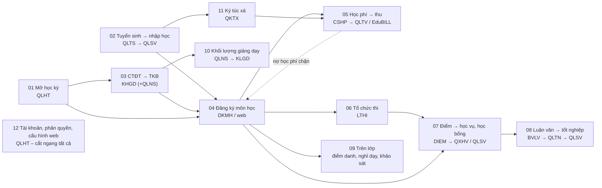

# Quy trình xuyên phân hệ – một năm học đi qua những phân hệ nào

Đọc như một dây chuyền: **bước trước tạo dữ liệu, bước sau dùng**. Case ở bước nào thì:
1. kiểm **đầu vào** từ các bước trước (nhiều case "lỗi" thật ra do dữ liệu / cài đặt phía trước chưa đúng);
2. sau khi sửa, kiểm **các bước sau** dùng dữ liệu đó.

Xem dạng hình: [[00 Vòng đời đào tạo.canvas|Canvas vòng đời đào tạo]] · [[00 Bản đồ phân hệ.canvas|Canvas bản đồ phân hệ]] · bảng: ![[Quy trinh.base]]

## Các quy trình
| # | Quy trình | Phân hệ chính | Muốn bắt đầu phải có |
|---|---|---|---|
| 01 | [[01 Mo hoc ky moi\|Mở học kỳ mới]] | [[QLHT]] | – (gốc của mọi thứ trong học kỳ) |
| 02 | [[02 Tuyen sinh - nhap hoc\|Tuyển sinh → nhập học]] | [[QLTS]] → [[QLSV]], [[QLTV]] | ngành / khối, lớp sinh viên |
| 03 | [[03 CTDT - TKB\|CTĐT → nhóm học → TKB]] | [[KHGD]] | danh mục đào tạo, lớp SV, viên chức, học kỳ |
| 04 | [[04 Dang ky mon hoc\|Đăng ký môn học]] | [[DKMH]], web | DS SV học kỳ + nhóm học có TKB + ràng buộc + thời gian |
| 05 | [[05 Hoc phi - thu - thanh toan\|Học phí → thu → EduBILL]] | [[CSHP]], [[QLTV]], [[EDUBILL]] | KQ ĐKMH + chính sách học phí |
| 06 | [[06 To chuc thi\|Tổ chức thi]] | [[LTHI]] | KQ ĐKMH + nhóm học + phòng |
| 07 | [[07 Diem - hoc vu - hoc bong\|Điểm → học vụ, học bổng]] | [[DIEM]], [[QXHV]] | KQ ĐKMH (+ danh sách thi / phách) |
| 08 | [[08 Tot nghiep - luan van\|Luận văn → tốt nghiệp]] | [[BVLV]], [[QLTN]] | điểm TB + CTĐT |
| 09 | [[09 Hoat dong tren lop\|Trên lớp: điểm danh, nghỉ dạy, khảo sát]] | web, [[KHGD]], [[KSDG]] | TKB + danh sách lớp học phần |
| 10 | [[10 Nhan su - khoi luong giang day\|Nhân sự → khối lượng giảng dạy]] | [[QLNS]], [[KLGD]] | viên chức + nhóm học + TKB |
| 11 | [[11 Ky tuc xa\|Ký túc xá]] | [[QKTX]] | DS SV học kỳ |
| 12 | [[12 Tai khoan - phan quyen - web\|Tài khoản, phân quyền, cấu hình web]] | [[QLHT]] | – (cắt ngang) |

## Ví dụ đọc chuỗi
- **"SV không đăng ký được môn"** → [[04 Dang ky mon hoc]]: SV có trong DS SV học kỳ chưa ([[02 Tuyen sinh - nhap hoc]]), nhóm có TKB chưa ([[03 CTDT - TKB]]), thời gian online đủ 4 chỗ + restart IIS chưa, có nợ học phí không ([[05 Hoc phi - thu - thanh toan]]).
- **"Học phí tính sai"** → [[05 Hoc phi - thu - thanh toan]]: KQ ĐKMH đúng chưa → đơn giá / nhóm môn → diện chính sách → phụ thu → mới tới công thức.
- **"Nút Đóng học phí không hiện"** → EduBILL: học kỳ ở *Thời gian đóng học phí ngân hàng theo SV* có trùng *học kỳ thu học phí* trong Chỉnh định chung không.
- **"Đã cài mà không chạy"** ở học kỳ mới → [[01 Mo hoc ky moi]] (biến theo học kỳ) và [[12 Tai khoan - phan quyen - web]] (restart IIS, học kỳ web).

## Quan hệ khác
- Chi tiết dữ liệu: [[00 Logic nghiệp vụ]] (muốn có X phải có Y), từng phân hệ có mục **Chuỗi phân hệ (bắc cầu)**.
- Nguồn: [[00 Tài liệu nguồn]] – lưu đồ LuuDo_NEW + HDSD SharePoint.
- Trường làm khác bản chung → [[00 Mô hình trường]].
